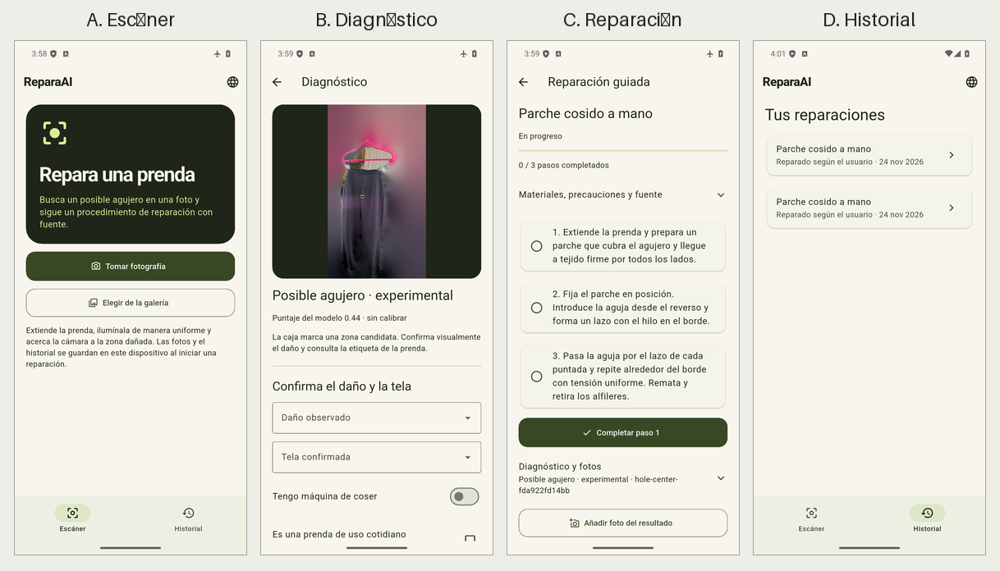
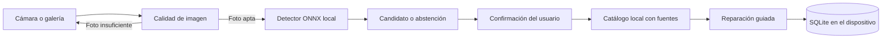

# ReparaAI

Aplicación Android para analizar una fotografía de una prenda, consultar una guía de reparación con fuente y guardar el progreso y el resultado sin conexión. La interfaz inicia en español y permite cambiar a inglés. El trabajo de investigación **UCRA** evalúa localización visual de agujeros y el efecto de la abstención.

[Artículo IEEE en español](research/paper/dist/reparaai-ieee-es.pdf) · [Pruebas](docs/TESTING.md) · [Estado del proyecto](docs/PROJECT_STATUS.md) · [Preparación para Google Play](docs/PLAY_STORE.md)

## Flujo de una reparación

1. Toma una fotografía o selecciónala desde el dispositivo. La app verifica resolución, iluminación y enfoque.
2. Inspecciona la zona sugerida por el detector experimental o identifica el daño por tu cuenta cuando se abstiene.
3. Confirma el daño, el tejido y las herramientas disponibles. El catálogo local ofrece procedimientos para agujeros, desgarros o costuras rectas abiertas según ese contexto.
4. Abre el procedimiento, revisa su fuente y marca los pasos completados. Si sales de la app, puedes continuar desde Historial.
5. Adjunta una foto del resultado y registra el desenlace. Los datos quedan en el teléfono. La guía original se abre en el navegador si hay conexión.



## Instalación y ejecución local

**Requisitos** · Flutter 3.38.3, SDK Android con API 36 y JDK 17 o superior. Usa Android Studio Device Manager o un teléfono con depuración USB. El mínimo de instalación es Android 7.0 (API 24). [Instalar Flutter](https://docs.flutter.dev/install)

```sh
git clone https://github.com/OwerLopez/RepairAI.git
cd RepairAI/apps/mobile
flutter doctor
flutter pub get --enforce-lockfile
flutter devices
flutter run -d ID_DEL_DISPOSITIVO
```

El modelo y el catálogo vienen incluidos en el código. La app arranca y funciona sin variables de entorno, cuenta ni servidor. Para instalar el APK de pruebas en un teléfono ARM64, compila desde `apps/mobile` y usa el archivo ubicado en `build/app/outputs/flutter-apk/app-arm64-v8a-release.apk`.

```sh
flutter build apk --release --target-platform android-arm64 --split-per-abi
adb install -r build/app/outputs/flutter-apk/app-arm64-v8a-release.apk
```

Para un emulador x86_64, sustituye `android-arm64` por `android-x64` y usa `app-x86_64-release.apk`. La firma por defecto es de desarrollo. Consulta la [guía de firma y distribución](docs/PLAY_STORE.md) para generar un AAB con la clave de carga. El flujo local no requiere hosting.

## Arquitectura



| Carpeta | Contenido |
| --- | --- |
| [apps/mobile](apps/mobile/) | Flutter, Android, proyecto iOS, visión, catálogo y diario |
| [ml](ml/) | Adquisición, validación, entrenamiento, exportación y figuras |
| [research](research/) | Dataset, protocolo, resultados, figuras y manuscritos |
| [scripts](scripts/) | Prueba del flujo real por ADB |
| [docs](docs/) | Arquitectura, QA, estado, privacidad y distribución |
| [.github/workflows](.github/workflows/) | Validación continua del código, tabla experimental y compilación |

La app separa la región sugerida, la observación del usuario y el resultado declarado. Guarda una copia JPEG sin metadatos EXIF y conserva una copia del plan y su referencia. El historial vive en el almacenamiento privado de la app. Se puede eliminar una sesión y sus fotos desde Historial. [Decisión de arquitectura](docs/adr/001-local-first-pilot.md), [datos en el dispositivo](docs/PRIVACIDAD.md)

## Pruebas

```sh
cd apps/mobile
flutter analyze
flutter test
```

La prueba de integración usa un emulador Android y una fotografía real de CISUTAC. Abre la galería nativa, confirma contexto, comprueba la reanudación después de detener el proceso y verifica el resultado en SQLite. Incluye una comprobación de cambio de idioma. Las instrucciones y el registro reproducible están en la [guía de QA](docs/TESTING.md).

## Investigación y artículo

La evaluación conserva una sola variante de mayor resolución por vista y asigna prendas completas a entrenamiento, validación o prueba. El modelo desplegado por mosaicos mostró 18 candidatos en 61 vistas de prueba, con 8 en la región anotada a IoU 0,25 y 7 a IoU 0,50. El conjunto de prueba contiene prendas con daño anotado. La especificidad, la generalización a teléfonos físicos y la evaluación de procedimientos con especialistas siguen pendientes.

- [Artículo IEEE A4 en español](research/paper/dist/reparaai-ieee-es.pdf) y [fuentes LaTeX](research/paper/)
- [Revisión de datasets y licencias](research/datasets/INVENTORY.md)
- [Protocolo de recolección, anotación y evaluación](research/methodology/ANNOTATION.md)
- [Resultados y reproducción de experimentos](research/experiments/)
- [Historial de implementación](docs/IMPLEMENTATION_LOG.md)

**Autores** · Lopez Arela, Ower Frank · Zegarra Puma, Mauricio Eduardo · Huamani Chañi, Diego Oswaldo.

**Atribución** · Se acredita a CISUTAC y Wargön Innovation por la revisión de [Garment Condition Holes](https://huggingface.co/datasets/wargoninnovation/Garment_condition_holes/tree/3b81cb807188690222ef2a6af9cbfd2271292a32) bajo [CC BY 4.0](https://creativecommons.org/licenses/by/4.0/). Se deduplicaron las vistas, se reasignaron por prenda y se convirtieron polígonos en cajas para entrenar y evaluar los modelos. La captura del artículo muestra una imagen del mismo conjunto. Cada entrada del catálogo cita el procedimiento que la respalda.

## English

ReparaAI is a bilingual offline Android app for screening garment photos, finding source-linked repair instructions, and keeping a repair journal. Use the globe button to switch to English. The hole detector is experimental and the repair plan relies on the user confirming the damage and fabric. The [English manuscript source](research/paper/main.tex) and [reproduction instructions](research/experiments/) describe the benchmark.
