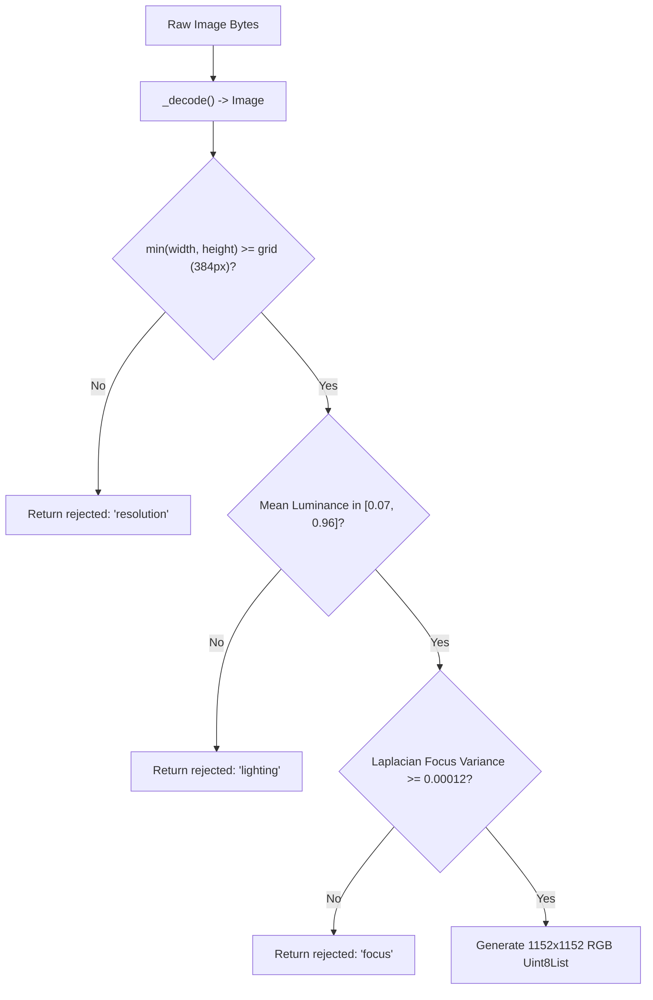

# ReparaAI Internal API Reference

This document provides a comprehensive technical reference for the core internal APIs, domain models, and processing pipelines in the ReparaAI codebase.

---

## Table of Contents

- [1. Data Models](#1-data-models)
  - [1.1 Scan](#11-scan)
  - [1.2 Procedure](#12-procedure)
  - [1.3 Session Record (SQLite)](#13-session-record-sqlite)
- [2. Vision API](#2-vision-api)
  - [2.1 Class: Vision](#21-class-vision)
  - [2.2 Quality Gating Pipeline](#22-quality-gating-pipeline)
  - [2.3 Sliding-Window Tile Inference](#23-sliding-window-tile-inference)
  - [2.4 Photo Preparation & Sanitization](#24-photo-preparation--sanitization)
- [3. Knowledge API](#3-knowledge-api)
  - [3.1 Class: Knowledge](#31-class-knowledge)
  - [3.2 Retrieval & Specificity Ranking Algorithm](#32-retrieval--specificity-ranking-algorithm)
- [4. Journal API](#4-journal-api)
  - [4.1 Class: Journal](#41-class-journal)
  - [4.2 Session CRUD Methods](#42-session-crud-methods)
  - [4.3 User Preferences Key-Value Store](#43-user-preferences-key-value-store)

---

## 1. Data Models

### 1.1 Scan

Located in `apps/mobile/lib/vision.dart`. Represents the immutable result of an image quality screening and ONNX inference run.

```dart
class Scan {
  const Scan(
    this.photo,
    this.status,
    this.model,
    this.elapsedMs, {
    this.box,
    this.score,
    this.focus,
  });

  final Uint8List photo;
  final String status;
  final String model;
  final int elapsedMs;
  final Rect? box;
  final double? score;
  final Offset? focus;

  Map<String, Object?> toJson();
}
```

#### Fields

| Field | Type | Description |
| :--- | :--- | :--- |
| `photo` | `Uint8List` | Clean, oriented, compressed JPEG image buffer suitable for rendering. |
| `status` | `String` | Status code of the scan. Possible values: `'candidate'` (damage detected above threshold), `'uncertain'` (model abstained; score below threshold), `'resolution'` (image below minimum dimension), `'lighting'` (image underexposed or overexposed), `'focus'` (image blurred or lacking edge detail). |
| `model` | `String` | Version identifier of the model deployed (e.g., `'hole-center-fda922fd14bb'`). |
| `elapsedMs` | `int` | Total wall-clock time in milliseconds taken for frame preparation and inference. |
| `box` | `Rect?` | Normalized bounding box in relative coordinates `[left, top, right, bottom]` where values are in range `[0.0, 1.0]`. `null` if no candidate was identified or quality checks failed. |
| `score` | `double?` | Sigmoid-activated confidence probability in range `[0.0, 1.0]`. `null` if quality checks failed. |
| `focus` | `Offset?` | User-defined focal search center `(dx, dy)` in normalized coordinates `[0.0, 1.0]`, if supplied. |

#### Methods

##### `Map<String, Object?> toJson()`
Serializes the scan result for persistence in the SQLite journal.
- **Returns**: A JSON-encodable map containing `status`, `model`, `elapsedMs`, `score`, `box` as `[left, top, right, bottom]`, and optionally `focus` as `[dx, dy]`.

---

### 1.2 Procedure

Located in `apps/mobile/lib/procedures.dart`. Encapsulates a structured, source-backed textile repair intervention loaded from `assets/procedures.json`.

```dart
class Procedure {
  const Procedure(this.data);

  final Map<String, dynamic> data;

  String get id;
  String get damage;
  List<String> get materials;
  String get source;
  Uri get url;
  bool get usesMachine;

  String title(int language);
  String tools(int language);
  List<String> steps(int language);
}
```

#### Properties

| Property | Type | Description |
| :--- | :--- | :--- |
| `data` | `Map<String, dynamic>` | Underlying raw JSON map for the procedure. |
| `id` | `String` | Unique alphanumeric identifier (e.g., `'denim-darn'`, `'woven-patch'`, `'straight-seam'`, `'woven-tear'`). |
| `damage` | `String` | Damage classification this procedure repairs: `'hole'`, `'seam'`, or `'tear'`. |
| `materials` | `List<String>` | Compatible textile types: e.g., `['denim']` or `['denim', 'woven']`. |
| `source` | `String` | Bibliographic citation of the procedure author (e.g., `'iFixit · How to Darn a Hole in Denim Jeans by Hand'`). |
| `url` | `Uri` | Verified canonical HTTPS URL pointing to the original public procedure documentation. |
| `usesMachine` | `bool` | Returns `true` if the procedure requires a sewing machine (`id == 'straight-seam'`). |

#### Methods

##### `String title(int language)`
Returns the localized title of the procedure.
- **Parameters**: `language` (`int`): `0` for Spanish, `1` for English.
- **Returns**: Localized title string.

##### `String tools(int language)`
Returns the localized string listing required equipment, needles, threads, or patches.
- **Parameters**: `language` (`int`): `0` for Spanish, `1` for English.
- **Returns**: Localized tools and materials description.

##### `List<String> steps(int language)`
Returns the ordered list of repair step instructions.
- **Parameters**: `language` (`int`): `0` for Spanish, `1` for English.
- **Returns**: List of localized instruction strings.

---

### 1.3 Session Record (SQLite)

Located in `apps/mobile/lib/journal.dart`. The relational schema representing a repair tracking session:

```sql
CREATE TABLE sessions (
  id INTEGER PRIMARY KEY,
  started TEXT NOT NULL,
  diagnosis TEXT NOT NULL,
  damage TEXT NOT NULL,
  material TEXT NOT NULL,
  knowledge TEXT NOT NULL,
  plan TEXT NOT NULL,
  before_photo BLOB NOT NULL,
  after_photo BLOB,
  completed_steps INTEGER NOT NULL DEFAULT 0,
  outcome TEXT CHECK(outcome IN ('repaired', 'partial', 'stopped')),
  finished TEXT,
  notes TEXT NOT NULL DEFAULT ''
);
```

| Column | Type | Nullable | Description |
| :--- | :--- | :--- | :--- |
| `id` | `INTEGER` | No (PK) | Auto-incrementing session identifier. |
| `started` | `TEXT` | No | ISO-8601 UTC timestamp of session creation. |
| `diagnosis` | `TEXT` | No | JSON string of the `Scan.toJson()` payload. |
| `damage` | `TEXT` | No | Confirmed damage type (`'hole'`, `'seam'`, `'tear'`). |
| `material` | `TEXT` | No | Confirmed textile material (`'denim'`, `'woven'`). |
| `knowledge` | `TEXT` | No | Version string of the knowledge catalog at execution. |
| `plan` | `TEXT` | No | Complete JSON snapshot of the selected `Procedure`. |
| `before_photo` | `BLOB` | No | Sanitized JPEG byte buffer of the garment before repair. |
| `after_photo` | `BLOB` | Yes | Sanitized JPEG byte buffer of the garment after repair. |
| `completed_steps` | `INTEGER` | No | Zero-based index of steps completed. Default: `0`. |
| `outcome` | `TEXT` | Yes | User self-reported outcome: `'repaired'`, `'partial'`, or `'stopped'`. `NULL` while in progress. |
| `finished` | `TEXT` | Yes | ISO-8601 UTC timestamp of session finalization. |
| `notes` | `TEXT` | No | Optional user notes or annotations. |

---

## 2. Vision API

Located in `apps/mobile/lib/vision.dart`.

### 2.1 Class: Vision

The main vision controller responsible for input validation, background isolate preprocessing, ONNX neural inference, coordinate normalization, and photo compression.

```dart
class Vision {
  Vision(Map<String, dynamic> model);

  final String version;
  final int grid;
  final int stride;
  final int inputGrid;
  final List<int> starts;
  final double threshold;

  static const double focusSize = 0.20;

  Future<Scan> scan(Uint8List bytes, {Offset? focus});
  static Future<Uint8List> preparePhoto(Uint8List bytes);
}
```

#### Constructor

```dart
Vision(Map<String, dynamic> model)
```
Initializes the vision configuration from a parsed JSON specification (typically `assets/hole_tile.json`).
- **Required JSON keys**:
  - `version` (`String`): Model hash and identifier (e.g., `'hole-center-fda922fd14bb'`).
  - `grid` (`int`): Tile size in pixels (`384`).
  - `stride` (`int`): Heatmap downsampling factor (`4`).
  - `input_grid` (`int`): Resampled full-image dimension (`1152`).
  - `tile_starts` (`List<dynamic>`): Offset coordinates for sliding tiles (`[0, 256, 512, 768]`).
  - `threshold` (`num`): Minimum sigmoid confidence for candidate acceptance (`0.35`).

---

### 2.2 Quality Gating Pipeline

Quality checks are executed in a background isolate (`_prepareFrame`) before initializing any ONNX sessions:



#### Detailed Heuristics

1. **Resolution Check**:
   $$\min(\text{width}, \text{height}) \ge \text{grid}$$
   Requires at least $384\text{px}$ along the shorter dimension. Prevents evaluating low-resolution thumbnails or corrupted assets.

2. **Lighting / Exposure Check**:
   The image is subsampled to a $\text{grid} \times \text{grid}$ grayscale buffer using ITU-R BT.601 coefficients:
   $$Y = \frac{77 \cdot R + 150 \cdot G + 29 \cdot B}{256 \times 255}$$
   $$\text{mean} = \frac{1}{N}\sum Y$$
   Rejects images with $\text{mean} < 0.07$ (severely underexposed / dark) or $\text{mean} > 0.96$ (severely overexposed / washed out).

3. **Laplacian Blur / Focus Check**:
   A discrete 2D 4-point Laplacian kernel:
   $$L(x, y) = -4 Y(x, y) + Y(x, y+1) + Y(x, y-1) + Y(x+1, y) + Y(x-1, y)$$
   Computes mean squared edge variance across the inner grid:
   $$\text{variance} = \frac{1}{(n - 2)^2} \sum L(x, y)^2$$
   Rejects images where $\text{variance} < 0.00012$, capturing blurry or unfocused photos where textile fibers cannot be resolved.

---

### 2.3 Sliding-Window Tile Inference

#### Method: `Future<Scan> scan(Uint8List bytes, {Offset? focus})`

Executes the screening pipeline.

- **Parameters**:
  - `bytes` (`Uint8List`): Raw encoded image data (JPEG, PNG). Maximum allowed size: 28 MB.
  - `focus` (`Offset?`, optional): Normalized `(dx, dy)` point designated by the user to focus detection.
- **Returns**: `Future<Scan>` representing candidate bounding box or rejection/abstention reason.

#### Processing Steps:
1. Spawns `compute(_prepareFrame)` to produce clean display JPEG and 1152x1152 RGB buffer.
2. If quality gates reject the frame, returns `Scan(photo, rejectedReason, version, elapsedMs)`.
3. Creates native ONNX session with 2 threads from `assets/hole_tile.onnx`.
4. Loops through sliding window coordinates `starts` $\times$ `starts` (16 tiles of 384x384):
   - If `focus` is provided, skips any tile whose bounding box does not intersect a 20% area centered on `focus`.
   - Copies normalized RGB pixel channels into `Float32List(1 * 3 * 384 * 384)`.
   - Passes tensor to ONNX session input `'image'`.
   - Reads output tensors `'heatmap'` (confidence grid) and `'geometry'` (4-channel box coordinates: $dx, dy, \text{log}(w), \text{log}(h)$).
   - Computes logistic sigmoid score: $\sigma(\text{logit}) = \frac{1}{1 + e^{-\text{logit}}}$.
   - Unprojects local tile coordinates into normalized full-image bounds $[0.0, 1.0]$.
5. Tracks global maximum score and corresponding box.
6. Returns `Scan` with status `'candidate'` if $\text{best} \ge \text{threshold}$, or `'uncertain'` if below threshold.
7. Guarantees session and tensor disposal via `finally`.

---

### 2.4 Photo Preparation & Sanitization

#### Static Method: `Future<Uint8List> preparePhoto(Uint8List bytes)`

Sanitizes, strips metadata, and compresses an evidence photograph.

- **Parameters**: `bytes` (`Uint8List`): Raw image byte array.
- **Returns**: `Future<Uint8List>`: Re-encoded, EXIF-free JPEG byte array.
- **Guarantees**:
  - Applies `image.bakeOrientation()` so rotated camera shots render upright.
  - Strips all EXIF metadata tags, removing GPS coordinates and device identifiers.
  - Bounds maximum dimension to 1280px via `image.copyResize(interpolation: Interpolation.average)`.
  - Progressively evaluates JPEG quality levels `[78, 60, 40]` to ensure output file size $\le 450\text{ KB}$.
  - Fallback: resizes to 640px at 55% quality if file remains over 450 KB.

---

## 3. Knowledge API

Located in `apps/mobile/lib/procedures.dart`.

### 3.1 Class: Knowledge

Manages in-memory retrieval of curated textile repair guides.

```dart
class Knowledge {
  Knowledge(Map<String, dynamic> json);

  final String version;
  final List<Procedure> procedures;

  List<Procedure> retrieve({
    required String damage,
    required String material,
    required bool machineAvailable,
  });
}
```

#### Constructor

```dart
Knowledge(Map<String, dynamic> json)
```
Parses the catalog definition (typically loaded from `assets/procedures.json`).
- Sets `version` (`String`).
- Instantiates the `procedures` list.

---

### 3.2 Retrieval & Specificity Ranking Algorithm

#### Method: `List<Procedure> retrieve(...)`

Filters and ranks procedures matching the user's repair constraints.

```dart
List<Procedure> retrieve({
  required String damage,
  required String material,
  required bool machineAvailable,
})
```

#### Parameters

| Parameter | Type | Description |
| :--- | :--- | :--- |
| `damage` | `String` | Confirmed damage type (`'hole'`, `'seam'`, `'tear'`). |
| `material` | `String` | Confirmed garment textile (`'denim'`, `'woven'`). |
| `machineAvailable` | `bool` | Whether the user has access to a sewing machine. If `false`, machine-dependent procedures (`straight-seam`) are excluded. |

#### Specificity Ranking Rules:
1. **Filtering**: Retains only procedures where:
   $$\text{procedure.damage} == \text{damage} \land \text{material} \in \text{procedure.materials} \land (\text{machineAvailable} \lor \neg \text{procedure.usesMachine})$$
2. **Sorting by Specificity**:
   Sorts compatible procedures ascending by `materials.length`. A procedure tailored specifically to `['denim']` is given higher priority than a general procedure that applies to `['denim', 'woven']`.
3. **Deterministic Tie-Breaking**:
   Ties in material scope length are broken alphabetically by `procedure.id`.

---

## 4. Journal API

Located in `apps/mobile/lib/journal.dart`.

### 4.1 Class: Journal

Provides relational persistence for repair tracking sessions and user settings. Implements cross-platform storage: native SQLite (`sqflite`) on mobile; WebAssembly SQLite (`sqflite_common_ffi_web`) on web.

```dart
class Journal {
  Journal();

  Future<int> start({
    required Map<String, Object?> diagnosis,
    required String damage,
    required String material,
    required String knowledge,
    required Map<String, dynamic> plan,
    required Uint8List photo,
  });

  Future<List<Map<String, Object?>>> list();
  Future<Map<String, Object?>> read(int id);
  Future<void> advance(int id, int step);
  Future<void> evidence(int id, Uint8List photo);
  Future<void> finish(int id, String outcome, String notes);
  Future<void> delete(int id);

  Future<String?> preference(String key);
  Future<void> setPreference(String key, String? value);
}
```

---

### 4.2 Session CRUD Methods

#### `Future<int> start(...)`
Creates a new active repair session in the database.
- **Parameters**:
  - `diagnosis` (`Map<String, Object?>`): Serialized diagnostic dictionary (`Scan.toJson()`).
  - `damage` (`String`): Confirmed damage classification.
  - `material` (`String`): Confirmed garment material.
  - `knowledge` (`String`): Version of the knowledge engine.
  - `plan` (`Map<String, dynamic>`): Full JSON data of the chosen `Procedure`.
  - `photo` (`Uint8List`): Sanitized initial garment photo bytes.
- **Returns**: `Future<int>`: The generated primary key `id`.

#### `Future<List<Map<String, Object?>>> list()`
Queries lightweight session summaries for the history list view.
- **Columns returned**: `['id', 'started', 'plan', 'completed_steps', 'outcome']`.
- **Order**: `id DESC` (most recent first).
- **Returns**: `Future<List<Map<String, Object?>>>`.

#### `Future<Map<String, Object?>> read(int id)`
Retrieves a single complete session record by ID.
- **Parameters**: `id` (`int`): Primary key.
- **Returns**: `Future<Map<String, Object?>>`: Complete database row map including photo BLOBs.

#### `Future<void> advance(int id, int step)`
Idempotently marks a repair step as completed.
- **Parameters**:
  - `id` (`int`): Primary key.
  - `step` (`int`): Zero-based step index just completed.
- **Logic**: Executes SQL `UPDATE sessions SET completed_steps = step + 1 WHERE id = ? AND completed_steps = ? AND outcome IS NULL`. Prevents race conditions and will not modify completed sessions.

#### `Future<void> evidence(int id, Uint8List photo)`
Attaches an after-repair photo BLOB to an active session.
- **Parameters**:
  - `id` (`int`): Primary key.
  - `photo` (`Uint8List`): Sanitized after-repair JPEG byte array.
- **Logic**: Executes SQL `UPDATE sessions SET after_photo = ? WHERE id = ? AND outcome IS NULL`.

#### `Future<void> finish(int id, String outcome, String notes)`
Finalizes and closes a repair session.
- **Parameters**:
  - `id` (`int`): Primary key.
  - `outcome` (`String`): One of `'repaired'`, `'partial'`, or `'stopped'`.
  - `notes` (`String`): User reflections, tips, or mending notes.
- **Logic**: Sets `outcome`, trimmed `notes`, and UTC `finished` timestamp `WHERE id = ? AND outcome IS NULL`.

#### `Future<void> delete(int id)`
Permanently deletes a repair session and removes all associated photos.
- **Parameters**: `id` (`int`): Primary key.
- **Logic**: Executes SQL `DELETE FROM sessions WHERE id = ?`.

---

### 4.3 User Preferences Key-Value Store

#### `Future<String?> preference(String key)`
Reads a persistent preference string.
- **Parameters**: `key` (`String`): Key name (e.g., `'locale'`, `'pendingCapture'`).
- **Returns**: Stored `String` value or `null` if the key does not exist.

#### `Future<void> setPreference(String key, String? value)`
Sets or deletes a persistent preference.
- **Parameters**:
  - `key` (`String`): Key name.
  - `value` (`String?`): Value to persist. If `value == null`, the entry is deleted from the `preferences` table.
- **Conflict Algorithm**: `ConflictAlgorithm.replace`.
