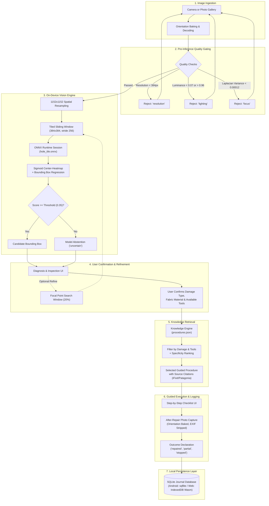

# ReparaAI Architecture

ReparaAI is an offline-first, privacy-by-design mobile and web application designed for on-device textile damage screening, source-backed repair procedure matching, and guided journal tracking. The system operates fully self-contained on the client device without requiring external cloud inference, user authentication, or server synchronization.

---

## 1. System Overview

ReparaAI addresses garment longevity and circular fashion by lowering the barrier to textile repair. The application bridges visual edge machine learning with structured mending knowledge:

- **Local-First & Offline Resilience**: Ingestion, quality checks, neural network inference, procedure filtering, and repair tracking run directly on the client hardware. In-flight operations work seamlessly in airplane mode.
- **Human-in-the-Loop Validation**: Machine learning predictions are treated strictly as advisory candidates. The system enforces user confirmation of damage presence, damage type, textile weave/knit material, and tool availability before retrieving a repair plan.
- **Zero-Telemetry Privacy**: Visual evidence and journal records are confined to the application sandbox. No EXIF metadata or telemetry is persisted or transmitted.
- **Universal Accessibility**: Bilingual runtime (Spanish default, English supported), cross-platform deployment across Android (API 24+) and Modern Web (via WebAssembly and WebGL/WebGPU ONNX Runtime).

---

## 2. Component Architecture & End-to-End Pipeline

The end-to-end user journey follows a strict pipeline from photo ingestion to local persistence:



---

## 3. Technology Stack

| Layer / Subsystem | Technology | Version | Purpose & Rationale |
| :--- | :--- | :--- | :--- |
| **UI Framework** | [Flutter SDK](https://flutter.dev) | 3.38.3 | Cross-platform declarative UI with native rendering performance on Android, Web, and iOS. |
| **Language** | [Dart](https://dart.dev) | ^3.10.1 | Strong typing, null safety, ahead-of-time (AOT) compilation, and isolate-based concurrency. |
| **Edge ML Runtime (Mobile)** | `flutter_onnxruntime` | 1.9.0 | Direct native bindings to Microsoft ONNX Runtime for CPU/NPU model inference with multithreading. |
| **Edge ML Runtime (Web)** | ONNX Runtime Web | 1.9+ | WebAssembly execution for client-side model inference in browser environments. |
| **Relational Storage (Mobile)** | `sqflite` | ^2.4.2+1 | Native SQLite bindings targeting Android sandbox application storage. |
| **Relational Storage (Web)** | `sqflite_common_ffi_web` / `sqlite3` | 0.4.5 / 2.9.4 | WebAssembly SQLite binary (`sqlite3.wasm`) with web-worker IndexedDB persistence. |
| **Image Processing** | `image` | ^4.13.1 | Pure Dart image decoding, orientation normalization, discrete Laplacian convolution, and JPEG encoding. |
| **Hardware Abstraction** | `image_picker` | ^1.2.3 | Android `Activity` and Web file input abstraction with activity-loss recovery support. |
| **External Interop** | `url_launcher` | ^6.3.2 | Intent-based dispatch to system browser for open-access repair guide verification. |
| **Internationalization** | `intl`, `flutter_localizations` | ^0.20.2 | Runtime locale switching (Spanish / English) without application restarts. |
| **Target Platforms** | Android SDK / Web | API 24–36 / Wasm | Android 7.0+ (ARM64, x86_64) with 16 KB ELF page alignment; static GitHub Pages deployment. |

---

## 4. Module Descriptions

```
apps/mobile/lib/
├── main.dart            # Application bootstrap, asset loading, locale initialization, root theme
├── glass.dart           # Aurora custom painter, frosted glass containers, palette definitions
├── ui.dart              # Responsive layout PageBody, PhotoPanel with bounding box, localization extensions
├── home.dart            # Main dashboard, capture action sheet, pending capture recovery, session history list
├── diagnosis_page.dart  # Interactive scan result screen, focal refinement, damage & fabric confirmation
├── repair_page.dart     # Step progression runner, source launcher, after-photo evidence, outcome finalization
├── vision.dart          # Image decoding, quality heuristics, sliding window ONNX inference, photo compression
├── procedures.dart      # Repair guide catalog, procedure models, deterministic specificity ranking algorithm
└── journal.dart         # SQLite persistence abstraction for repair sessions and key-value user preferences
```

### 4.1 Vision Engine (`lib/vision.dart`)
- **`Vision`**: Initialized with parameters from `assets/hole_tile.json` (grid size: 384, stride: 4, input grid: 1152, tile starts: `[0, 256, 512, 768]`, threshold: 0.35).
- **`Scan`**: Data transfer object holding the compressed display photo (`Uint8List`), scan status (`candidate`, `uncertain`, `resolution`, `lighting`, `focus`), model version signature, execution duration (`elapsedMs`), normalized bounding box (`Rect?`), confidence score (`double?`), and user-defined focal point (`Offset?`).
- **`_prepareFrame` (Isolate Worker)**: Runs off the main UI isolate via `compute()`. Decodes the image, bakes EXIF orientation, validates dimensions, runs luminance and Laplacian focus calculations, and generates an 1152x1152 3-channel interleaved RGB buffer.
- **`_displayPhoto`**: Downscales input images to a maximum dimension of 1280px, strips EXIF tags, and applies iterative JPEG compression (qualities 78 -> 60 -> 40 targeting <= 450 KB, fallback resize to 640px) to conserve database storage.

### 4.2 Knowledge Retrieval Engine (`lib/procedures.dart`)
- **`Procedure`**: Immutable wrapper around catalog JSON representing repair interventions. Exposes localized title, required tools, ordered step instructions, external source citation, reference URL, and machine requirement flag (`usesMachine`).
- **`Knowledge`**: Manages procedure retrieval based on user input. Implements deterministic filtering against damage type and material compatibility, while checking machine constraints.
- **Specificity Ranking Algorithm**: Compatible procedures are sorted in ascending order of their `materials.length`. A procedure tailored specifically for `["denim"]` is ranked ahead of a generalized procedure covering `["denim", "woven"]`.

### 4.3 Journal Storage Engine (`lib/journal.dart`)
- **`Journal`**: Encapsulates all relational database operations. Manages the `sessions` table (containing raw BLOBs for before/after photos, JSON-encoded diagnostic snapshots and repair plans, progress indices, and final outcomes) and the `preferences` key-value table.
- **Lifecycle Methods**:
  - `start()`: Atomically registers a new session and returns the auto-increment ID.
  - `list()`: Returns lightweight metadata summaries for the history list.
  - `read()`: Retrieves the complete session payload.
  - `advance()`: Idempotently increments the completed step counter.
  - `evidence()`: Records the after-repair photo BLOB.
  - `finish()`: Records final outcome status (`repaired`, `partial`, `stopped`), closing notes, and UTC timestamp.
  - `delete()`: Hard-deletes the session record and frees associated photo BLOB storage.
  - `preference()` / `setPreference()`: Persists user settings such as language selection and pending Android activity states.

### 4.4 User Interface Layer (`lib/home.dart`, `lib/diagnosis_page.dart`, `lib/repair_page.dart`, `lib/glass.dart`, `lib/ui.dart`)
- **Visual Design**: Utilizes an "Aurora & Frosted Glass" theme (`GlassBackdrop`, `_Aurora` custom shader with radial glows, and `GlassCard` surface styling) that stays consistent across dark and low-light environments.
- **Interactive Refinement**: Allows users to tap on the photo (`PhotoPanel`) to supply a focal point (`Offset`), scoping tile evaluation to a 20% spatial bounding box around the damage.
- **Crash/Process-Loss Recovery**: Registers pending camera interactions in `preferences` and recovers lost frames using `ImagePicker.retrieveLostData()` on Android resume.

---

## 5. Architectural & Software Design Patterns

### 5.1 Repository Pattern for the Journal
The `Journal` class implements the **Repository Pattern**, separating the domain model and presentation layer from database drivers and SQL syntax:
- Decouples storage mechanics from business logic: caller widgets do not interact with raw SQL or database connections.
- Bridges heterogeneous environments: on native Android and iOS, `sqflite` accesses the platform SQLite engine; on the Web, `sqflite_common_ffi_web` mounts a WebAssembly binary backed by IndexedDB.
- Encapsulates schema evolution and serialization: JSON encoding of diagnostic summaries and procedure plans is handled inside the repository boundary.

### 5.2 Strategy Pattern for Vision & Quality Pipelines
The vision subsystem employs the **Strategy Pattern** to decouple image ingestion, quality heuristics, and inference execution:
- **Quality Gating Strategies**: Decoupled verification steps evaluate minimum dimension (`resolution`), average luminance (`lighting`), and Laplacian second-derivative variance (`focus`). Any gate failure terminates execution early, conserving CPU cycles and battery life.
- **Sliding-Window Inference Strategies**: The inference pipeline supports either:
  1. *Global Sliding Window*: Full-grid stride across `[0, 256, 512, 768]` coordinates for broad screening.
  2. *Targeted Focal Window*: Spatially constrained evaluation restricting tile execution to those intersecting a user-designated 20% bounding region.

### 5.3 User-in-the-Loop Advisory Pattern
The system explicitly avoids autonomous destructive decision-making:
- The neural detector is treated as an *advisory screening tool*, not an autonomous arbiter.
- When confidence falls below 0.35, the system formally yields (`uncertain`) rather than hallucinates false damages.
- The user must explicitly select damage class, garment fabric, and equipment before knowledge retrieval queries are executed.

---

## 6. Security & Privacy Architecture

ReparaAI follows a zero-trust, local-first privacy posture:

```
[Camera / Gallery] ──> [Orientation Bake & EXIF Strip] ──> [Private App Sandbox]
                             (No GPS, No Camera Info)       (repairs.sqlite)
                                                                   │
                                                                   X  <-- Android Auto-Backup Disabled
                                                                   X  <-- No Cloud Telemetry / Sync
```

1. **Local-First Processing**: 100% of image analysis, model evaluation, and journal persistence occurs inside the device boundary. The application does not require or communicate with an application backend.
2. **Metadata Sanitization (EXIF Removal)**:
   - Photos selected from the device gallery or captured via camera often contain sensitive metadata, including precise GPS coordinates, capture timestamps, device serial numbers, and camera configurations.
   - During `Vision.preparePhoto()` and `_prepareFrame()`, the raw raster buffer is decoded, normalized, and reconstructed into a clean JPEG byte stream. All EXIF IFDs (including `gpsIfd`) are eliminated prior to SQLite insertion.
3. **Sandbox Isolation**: SQLite database files (`repairs.sqlite`) and temporary image buffers are created within internal application storage (`Context.getFilesDir()` / `getDatabasesPath()`), isolated by Linux UID permissions from third-party applications.
4. **Disabled Cloud Backup**: Android Auto Backup (`android:allowBackup="false"`) is explicitly configured in `AndroidManifest.xml` to prevent unintentional synchronization of sensitive private garment photographs to remote Google Drive backups.
5. **Data Sovereignty & Deletion**: Users have full control over data retention. Deleting a session via the UI immediately issues an atomic SQL `DELETE`, removing both the database metadata and associated JPEG BLOBs.
6. **Outbound URI Constraints**: External procedure references are opened exclusively via explicit system browser intents constrained to verified HTTPS schemes (`https://www.ifixit.com/...`).

---

## 7. Performance Engineering

### 7.1 Tile-Based Inference Optimization
Processing high-resolution mobile camera photographs directly through a heavy convolutional network exceeds mobile compute and memory budgets. ReparaAI resolves this through a tiled sliding-window architecture:
- Input images are normalized to an 1152x1152 coordinate space.
- The model accepts a compact 384x384 input window with a stride of 4.
- 16 overlapping tile combinations (`tile_starts: [0, 256, 512, 768]`) cover the entire garment surface without downsampling fine textile weave details.
- When the user provides a focal point, the algorithm prunes non-overlapping tiles, reducing inference operations by up to 75%.
- Intra-operator thread count is pinned to 2 (`OrtSessionOptions(intraOpNumThreads: 2)`), balancing multi-core throughput while preventing UI thread starvation and thermal throttling.

### 7.2 Isolate-Based Parallelism
Mobile devices experience frame drops (jank) if CPU-intensive image processing runs on the main thread:
- Pre-inference preprocessing (decoding, orientation rotation, Laplacian kernel calculation, and RGB buffer serialization) executes within a worker isolate using Flutter's `compute()`.
- Post-inference memory management guarantees prompt disposal: all `OrtValue` tensors and ONNX session handles are cleaned up inside `finally` blocks to prevent native memory leaks.

### 7.3 Multi-Tier Progressive Photo Compression
Evidence photographs are compressed via an adaptive tier mechanism before database insertion:
1. Photos larger than 1280px in width or height are downscaled using area-averaging interpolation (`Interpolation.average`).
2. Iterative JPEG encoding evaluates qualities `[78, 60, 40]`, retaining the highest quality that satisfies a strict upper bound of 450 KB.
3. If the file remains oversized, it is downscaled to 640px at 55% quality. This maintains rapid database query performance and prevents SQLite cursor window overflows.

---

## 8. Deployment & Distribution Architecture

### 8.1 Android Platform Deployment
- **Target OS Range**: Android 7.0 (API Level 24, `minSdkVersion`) through Android 16 (API Level 36, `targetSdkVersion`).
- **Binary Architecture**: Built as native Android Application Bundles (AAB) or split-per-ABI APKs (`arm64-v8a` for modern physical devices, `x86_64` for emulators and Chromebooks).
- **16 KB Memory Page Alignment**: Configured with `PAGE_ALIGNMENT_16K` in Gradle packaging options to support Android 15/16 memory page requirements:
  ```groovy
  packagingOptions {
      jniLibs {
          useLegacyPackaging false
      }
  }
  ```
- **Lifecycle Resilience**: Accommodates Android low-memory activity kills during high-resolution camera launches by caching operation intent in SQLite preferences and resuming state via `ImagePicker.retrieveLostData()`.

### 8.2 Web Deployment (GitHub Pages)
- **Zero-Install Web App**: Published statically to GitHub Pages via `.github/workflows/pages.yml`.
- **Wasm Runtime Architecture**:
  - `sqlite3.wasm` (v2.9.4) compiled for browser execution.
  - Dedicated service worker (`sqflite_sw.js`) proxying database transactions into browser IndexedDB storage.
  - ONNX Runtime Web loading models asynchronously from application assets.
  - Configured with relative base-href (`/RepairAI/`) and asset caching for offline PWA-like capability.
